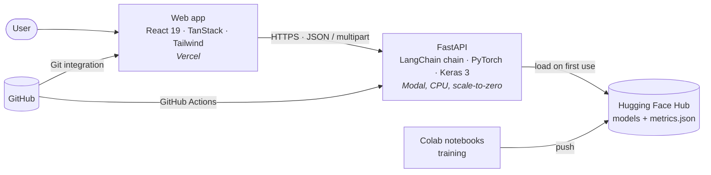
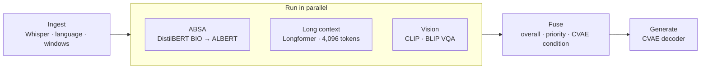

<div align="center">

# ReviewLens

**Explainable, multimodal analysis of e-commerce product reviews, in Vietnamese and English.**

Aspect-based sentiment · long-context reading · sentiment-conditioned image generation · photo and voice input · LIME explanations

[](https://github.com/YoungsterDumb/ReviewLens/actions/workflows/ci.yml)


</div>

---

## Overview

ReviewLens is the Chapter 3 capstone, *ABSA, Multimodal and XAI*. A shop owner pastes a review, attaches a photo or records a voice note, and gets back:

- **What the customer liked or disliked**: each aspect (battery, delivery, fit…) with its own sentiment, highlighted in the original text.
- **How urgent it is**: a support priority built from negative aspects, toxicity and photo defects.
- **Why the model decided that**: LIME word weights and photo heat-maps, each with a measured **fidelity** score.
- **What the product likely looks like**: a CVAE generates product images that match the review's sentiment.

It is a complete web application (React frontend, FastAPI backend), not a notebook demo.

## Architecture



| Part | Stack | Runs on |
| --- | --- | --- |
| [`frontend/`](frontend) | React 19, TypeScript, TanStack Router + Query + Devtools, Tailwind CSS v4, Vite | Vercel |
| [`backend/`](backend) | FastAPI, LangChain runnables, PyTorch, Transformers, Keras 3 | Modal (CPU, scales to zero) |
| [`training/`](training) | Colab notebooks over a tested Python package | Google Colab (T4) |

### The analysis pipeline

`POST /analyze` runs a single LangChain chain. Every step is timed and returned as a trace that the UI draws as a Gantt chart.



1. **Ingest**: Whisper transcribes a voice note, the language is detected, and text is split into sentence windows of at most 256 tokens.
2. **Parallel branches**: ABSA, long-context toxicity and vision run concurrently. Optional branches degrade with a warning instead of failing the request.
3. **Fuse**: overall sentiment, support priority, and the CVAE condition (product category plus a Word2Vec sentiment mix).
4. **Generate**: the CVAE decoder returns sentiment-matched image variants. Positive reviews give brighter images and negative reviews darker ones.

## Models

| Task | Model | Training data |
| --- | --- | --- |
| Aspect term extraction (ATE) | `distilbert-base-multilingual-cased`, BIO token classification | SemEval-2014 + UIT-ViSD4SA |
| Aspect sentiment (ATSC) | `cservan/multilingual-albert-base-cased-32k`, sentence-pair, class-weighted loss | SemEval-2014 + UIT-ViSD4SA |
| Long context | `AshtonIsNotHere/xlm-roberta-long-base-4096` (Longformer), trained at 1,024 tokens and evaluated at 4,096 | Jigsaw Toxic Comment |
| Image generator | Conditional VAE (Keras 3), Word2Vec sentiment condition | FashionMNIST |
| Speech to text | `openai/whisper-small` | pretrained |
| Visual question answering | `Salesforce/blip-vqa-base` | pretrained, evaluated on VQAv2 (MS-COCO) |
| Image understanding | `openai/clip-vit-base-patch32` (category, defect check, aspect alignment) | pretrained |
| Explainability | LIME text and image, with local fidelity | n/a |

All datasets are split 70 / 15 / 15 with a fixed seed.

## Evaluation targets

| Metric | Target | Status |
| --- | --- | --- |
| VAE reconstruction loss | < 0.01 | **0.0087**, met (CPU run, 20 epochs) |
| ABSA F1 (ATE, ATSC) | > 0.80 | Reported by notebook 01 |
| Long-context coverage | 4,096 tokens | Reported by notebook 02 |
| VQA accuracy | > 70% | Reported by notebook 04 |
| LIME fidelity | > 90% | Reported by notebook 05 |

Each notebook merges its results into `<hf-user>/reviewlens-metrics/metrics.json`. The web app's **Models** page reads that file and shows the live numbers against these targets, so the table above is never edited by hand.

Fidelity is defined as `1 − kernel-weighted MAE` between the LIME surrogate and the real model, measured on fresh perturbations that LIME did not train on.

## Getting started

### Prerequisites

Python 3.12, Node.js 22, and about 3 GB of disk for CPU PyTorch.

### Backend

```bash
cd backend
python -m venv .venv && . .venv/bin/activate
pip install torch --index-url https://download.pytorch.org/whl/cpu
pip install -r requirements.txt

# Stand-in models, no downloads: good for UI work
REVIEWLENS_STUB=true uvicorn app.main:get_app --factory --reload

# Real models, after training
REVIEWLENS_HF_NAMESPACE=<your-hf-user> uvicorn app.main:get_app --factory
```

### Frontend

```bash
cd frontend
npm install
VITE_API_URL=http://localhost:8000 npm run dev    # http://localhost:5173
```

TanStack Devtools (query cache and router state) are available in development and removed from the production build.

### Configuration

| Variable | Where | Purpose |
| --- | --- | --- |
| `VITE_API_URL` | frontend | Base URL of the API |
| `VITE_REPO_URL` | frontend | Link shown on the Models page (optional) |
| `REVIEWLENS_STUB` | backend | `true` swaps in lightweight stand-in models |
| `REVIEWLENS_HF_NAMESPACE` | backend | Hugging Face user that owns the `reviewlens-*` models |
| `REVIEWLENS_ALLOWED_ORIGINS` | backend | Comma-separated CORS origins (`*.vercel.app` is allowed by default) |

See [`backend/.env.example`](backend/.env.example) and [`frontend/.env.example`](frontend/.env.example).

## Training

Training runs on Google Colab (T4 GPU, about 2 hours in total). Open each notebook in [`training/notebooks/`](training/notebooks), set `REPO_URL` and `HF_NAMESPACE` in the first cell, and run all.

| # | Notebook | Output |
| --- | --- | --- |
| 1 | `01_absa_ate_atsc.ipynb` | `<user>/reviewlens-ate`, `<user>/reviewlens-atsc` |
| 2 | `02_long_context_longformer.ipynb` | `<user>/reviewlens-longctx` |
| 3 | `03_cvae_word2vec.ipynb` | CVAE and Word2Vec. The API already ships a decoder trained with this code |
| 4 | `04_multimodal_eval.ipynb` | VQA accuracy on MS-COCO, CLIP check, Whisper → LangChain demo |
| 5 | `05_xai_lime_eval.ipynb` | LIME fidelity on 200 test pairs |

Until notebooks 01 and 02 have published their models, the API reports the missing models in `/health` and `/analyze` returns `503`.

## Deployment

**API on Modal**

1. Create a free account at [modal.com](https://modal.com) and a token at **Settings → API Tokens**.
2. In the GitHub repo, add `MODAL_TOKEN_ID` and `MODAL_TOKEN_SECRET` under **Settings → Secrets and variables → Actions**. Optional repository variables: `HF_NAMESPACE`, `ALLOWED_ORIGINS`.
3. Push to `main`. The workflow [`deploy-backend.yml`](.github/workflows/deploy-backend.yml) runs `modal deploy` and prints `https://<workspace>--reviewlens-api.modal.run`.

The container has 4 CPUs and 12 GB of memory, scales to zero after 10 minutes idle, and caches downloaded weights in a Modal Volume to shorten cold starts.

**Web on Vercel**

1. Import the repository and set **Root Directory** to `frontend`.
2. Add the environment variable `VITE_API_URL` with the Modal URL.
3. Every push redeploys. `vercel.json` provides SPA rewrites, cache headers and security headers.

## Testing

```bash
cd backend  && pytest -q                      # API, pipeline, model wrappers, LIME fidelity, CVAE
pytest -q training/tests                      # data preparation (from the repo root)
cd frontend && npm run typecheck && npm test && npm run build
```

Backend tests use tiny offline models and a stub registry, so no network or GPU is needed. [`ci.yml`](.github/workflows/ci.yml) runs all three suites on every push.

## API reference

Interactive documentation is served at `/docs`.

| Method | Path | Purpose |
| --- | --- | --- |
| `GET` | `/health` | Mode (`live` or `stub`) and per-model load state |
| `POST` | `/warmup` | Start loading every model in the background |
| `GET` | `/metrics` | Evaluation metrics against targets |
| `POST` | `/analyze` | Multipart `text?`, `image?`, `audio?`, `lang?`, `category?`, `seed?` → full analysis |
| `POST` | `/explain/text` | `{text, aspect}` → LIME word weights and fidelity |
| `POST` | `/explain/image` | Multipart `image` → LIME heat-map and fidelity |
| `POST` | `/vqa` | Multipart `image`, `question` → answer |
| `POST` | `/generate` | `{category, sentiment, n, seed?, sweep?}` → CVAE images |
| `POST` | `/absa/batch` | `{texts[≤200]}` → per-review aspects and summary |

Errors use one envelope: `{"error": {"code": "...", "message": "..."}}`.

## Repository layout

```
reviewlens/
├── backend/
│   ├── app/
│   │   ├── core/        text windows, BIO tagging, CVAE, LIME fidelity (pure functions)
│   │   ├── models/      ATE, ATSC, long-context, speech, vision, generator wrappers
│   │   ├── pipeline/    LangChain chain and result fusion
│   │   ├── xai/         LIME text and image explainers
│   │   └── main.py      FastAPI app
│   ├── assets/cvae/     trained decoder and sentiment anchors
│   ├── modal_app.py     Modal deployment
│   └── tests/
├── frontend/            React app, tests, vercel.json
├── training/
│   ├── notebooks/       Colab notebooks 01 to 05
│   └── reviewlens_train/ data loading, trainers, evaluation, Hub publishing
└── .github/workflows/   CI and Modal deploy
```

## Design notes

- **No LLM in the chain.** LangChain composes runnables only, which keeps inference deterministic and free to run.
- **Graceful degradation.** Aspect extraction and sentiment are required; long-context, vision and generation are optional and report a warning when unavailable.
- **Vietnamese aspects are category-typed** (for example `B-BATTERY`), following UIT-ViSD4SA, while English uses generic `B-ASP` / `I-ASP`.
- **Scale to zero.** The first request after idle time warms the models; the UI shows a status chip and triggers one warm-up.


